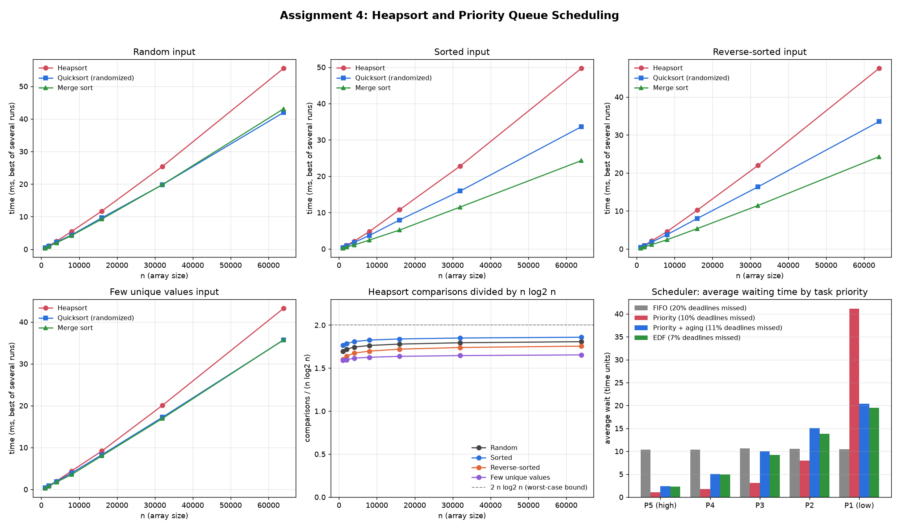

# Assignment 4: Heap Data Structures

Heapsort, a binary-heap priority queue, and a CPU scheduler simulation built on that queue, all in Python.



## Files

```
assignment-04-heap-data-structures/
├── src/
│   ├── heapsort.py             heapsort + an instrumented version that counts comparisons
│   ├── sorting_algorithms.py   randomized quicksort and merge sort, for comparison
│   ├── priority_queue.py       Task class and the binary-heap PriorityQueue
│   ├── scheduler.py            single-CPU scheduler simulation (FIFO, Priority, aging, EDF)
│   ├── benchmark.py            runs the experiments, writes the CSVs to results/
│   └── plot_results.py         reads the CSVs, draws results/heap_results.png
├── tests/
│   └── test_algorithms.py      correctness tests (pytest or plain python)
├── results/
│   ├── sorting.csv             running times and heapsort comparison counts
│   ├── scheduler.csv           waiting times and deadline misses per policy
│   ├── benchmark_console.txt   full console output of the benchmark
│   ├── environment.txt         Python version and machine the results came from
│   └── heap_results.png        the chart
├── README.md
└── REPORT.md                   design choices, complexity analysis, discussion
```

## How to run

You need Python 3.8+ and matplotlib.

Run everything from the `assignment-04-heap-data-structures` folder.

```bash
pip install matplotlib pytest

python -m pytest tests            # correctness tests (or: python tests/test_algorithms.py)
python src/benchmark.py           # sorting benchmark + scheduler simulation, ~20 seconds
python src/benchmark.py --quick   # smaller sizes, a few seconds
python src/plot_results.py        # draws results/heap_results.png from the CSVs
```

`benchmark.py` prints the sorting and scheduler tables and saves them to `results/`. Running times depend on the machine, so your numbers will differ a little from mine, but the patterns should be the same. The comparison counts and scheduler results use fixed random seeds, so they come out identical every time.

## Using the priority queue

From inside `src/` (or with `src/` on your Python path):

```python
from priority_queue import PriorityQueue, Task

pq = PriorityQueue(mode="max", key="priority")   # or mode="min", key="deadline", etc.
a = Task(task_id=1, priority=3, arrival_time=0.0, duration=2.0, deadline=10.0)
b = Task(task_id=2, priority=7)
pq.insert(a)
pq.insert(b)
pq.increase_key(a, 9)        # a now outranks b
pq.extract_max()             # -> a
pq.decrease_key(b, 1)
pq.is_empty()                # -> False
```

Every operation except `is_empty`, `peek` and `len` is O(log n). `increase_key` and `decrease_key` stay O(log n) because the queue keeps a `task_id -> index` map, so it never has to search for the task.

## Summary of findings

**Heapsort**

- Heapsort did between 1.6 and 1.9 · n log₂ n comparisons on every input type (random, sorted, reverse-sorted, few unique values), and that ratio stayed flat as n grew from 1,000 to 64,000. That's Θ(n log n) on every input, as the analysis predicts. The only way to beat it is all-equal keys, which drops it to O(n).
- It was the slowest of the three algorithms in every case, about 1.4 to 2 times slower than quicksort and merge sort, because of its larger constant (more comparisons and index arithmetic per step) and its jumpy memory access pattern.
- It was also the least sensitive to input order. Merge sort sped up about 30% on presorted input, and quicksort's random pivot made it indifferent to order.
- Its real strength is the combination of an O(n log n) worst case and O(1) extra memory, which neither of the other two has.

**Priority queue and scheduling** (5,000 tasks, one CPU, 95% busy)

| Policy | Avg wait | Max wait | Deadlines missed | High-priority wait | Low-priority wait |
|---|---|---|---|---|---|
| FIFO | 10.5 | 38.8 | 19.8% | 10.3 | 10.5 |
| Priority (max-heap) | 11.1 | 198.8 | 9.5% | 1.1 | 41.1 |
| Priority + aging | 10.6 | 57.0 | 11.3% | 2.4 | 20.4 |
| EDF (min-heap on deadline) | 10.0 | 70.4 | 6.6% | 2.3 | 19.5 |

- Average wait is almost the same for every policy, since none of them changes the total amount of work. The policy only decides who waits.
- Strict priority cuts high-priority waits roughly tenfold compared to FIFO but starves low-priority tasks (worst wait almost 200).
- Aging, implemented with `increase_key`, halves low-priority waits and cuts the worst case by about 70%, at a small cost to high-priority tasks.
- Earliest Deadline First misses the fewest deadlines, about a third as many as FIFO.

See `REPORT.md` for the full analysis.
