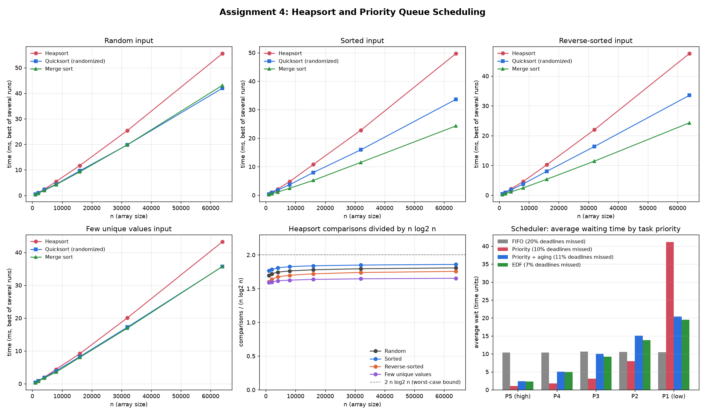

# Assignment 4 Report: Heap Data Structures

The code is in `src/` (`heapsort.py`, `sorting_algorithms.py`, `priority_queue.py`, `scheduler.py`), and the tests are in `tests/test_algorithms.py`. The figures below come from `python src/benchmark.py`, which saves raw results to `results/sorting.csv` and `results/scheduler.csv`; `python src/plot_results.py` draws the chart. Timings are the best of 5 runs with Python's garbage collector paused; exact numbers will vary from machine to machine but the patterns hold.

---

## Part 1: Heapsort

### 1. Implementation

A binary max-heap is stored directly in the array being sorted, using the usual index arithmetic: the children of index `i` are `2i + 1` and `2i + 2`, and its parent is `(i - 1) // 2`. Heapsort has two phases.

**Build the max-heap.** Call `_sift_down` on every internal node, starting from the last one (`n//2 - 1`) and working back to the root. Leaves are already one-element heaps, so they are skipped. When a node is sifted, both of its subtrees are already heaps, so after the sift the whole subtree rooted there is a heap.

**Extract the maximum repeatedly.** The largest element is always at index 0. Swap it with the last element of the heap region, which puts it in its final sorted position, shrink the heap by one, and sift the new root down to restore the heap property. After `n - 1` rounds the array is sorted in ascending order.

`_sift_down` is iterative instead of recursive, so there's no function call per level and no recursion limit. It also holds the value being sifted aside and slides larger children up into the gap, writing the value once at the end. That does the same comparisons as the textbook MAX-HEAPIFY with roughly half the array writes.

For comparison, `sorting_algorithms.py` has a randomized quicksort (Hoare partition, explicit stack) and a bottom-up merge sort with a single auxiliary buffer.

### 2. Time complexity

Let h = ⌊log₂ n⌋ be the height of the heap. One call to sift-down moves an element down at most one level per iteration and does at most 2 comparisons per level, so it costs O(height of the node).

**Building the heap is O(n), not O(n log n).** Most nodes are near the bottom, where sifting is cheap. A heap of n elements has at most ⌈n / 2^(k+1)⌉ nodes at height k, so the total cost is

  Σ_{k=0}^{h} ⌈n / 2^(k+1)⌉ · O(k) = O(n · Σ_{k≥0} k / 2^k) = O(n · 2) = O(n).

The series Σ k/2^k converges to 2, which is why the bound is linear.

**The extraction phase is O(n log n).** There are n − 1 extractions. Each one does an O(1) swap and a sift-down from the root of a heap with at most n elements, which is at most 2⌊log₂ n⌋ comparisons. Total: at most 2n log₂ n comparisons, so O(n log n).

**Worst case:** O(n) + O(n log n) = **O(n log n)**. Nothing about the input can make it worse, since the heap's shape is fixed by n alone. A heap is always a complete binary tree, so its height is always ⌊log₂ n⌋. This is the big difference from quicksort, whose recursion tree shape depends on the pivots, and that's what lets quicksort degrade to O(n²).

**Average case:** also **Θ(n log n)**, around 2n log₂ n comparisons for the standard version. The extraction phase dominates. The element swapped into the root comes from the bottom of the heap, so it's one of the smallest remaining values and almost always sinks most of the way back down. So the typical extraction costs close to the full 2 log₂ n.

**Best case:** **Θ(n log n) when all keys are distinct.** This is less obvious than the worst case, because the comparison sorting lower bound of Ω(n log n) is a statement about the worst case, not about every input. For heapsort specifically, Schaffer and Sedgewick (1993) showed that even the best input with distinct keys needs about ½ n log₂ n comparisons. The intuition is the same as above: whatever the input, the value moved to the root after each extraction is a leaf, so it's small relative to what's left, and a large fraction of extractions have to sift it down Ω(log n) levels. Rearranging the input can't avoid this because the build phase reshuffles it anyway.

The one exception is duplicate keys. If every key is equal, each sift-down stops after its first comparison, so heapsort runs in **O(n)**. I measured this directly: on 64,000 equal values heapsort did 3.0 comparisons per element, against about 29 per element on random input.

**Measured comparison counts** (comparisons divided by n log₂ n, from `heapsort_comparisons`):

| Input | n = 1,000 | n = 64,000 |
|---|---|---|
| Random | 1.70 | 1.81 |
| Sorted | 1.76 | 1.86 |
| Reverse-sorted | 1.60 | 1.76 |
| Few unique values (10 distinct) | 1.59 | 1.65 |

Every ratio is flat in n and stays under the 2 n log₂ n bound, which is exactly what Θ(n log n) on every input type looks like. The small differences between rows make sense too:

- **Reverse-sorted** input is already a valid max-heap (each element is ≥ everything after it), so the build phase does almost no work.
- **Sorted** input is the opposite: the smallest elements start at the top, so the build phase does the most work. But since building is only O(n), it only nudges the ratio.
- **Few unique values** has lots of ties, and sift-down stops as soon as no child is strictly bigger, so it does slightly less work.

### 3. Space complexity and overheads

- **Extra space: O(1).** Heapsort sorts in place. The heap lives inside the input array, and the iterative sift-down uses only a few local variables. A recursive MAX-HEAPIFY would add O(log n) stack space. Compare merge sort, which needs an O(n) buffer, and quicksort, which needs an O(log n) stack.
- **Not stable.** The swap from the root to the end can move equal keys past each other.
- **Poor memory locality.** Going from `i` to `2i + 1` jumps further and further through the array as you go down the heap, so in a compiled language most of these accesses miss the cache. Quicksort and merge sort scan memory sequentially. This is the main reason heapsort is usually slower in practice despite having the same O(n log n).
- **Larger constant.** About 2 n log₂ n comparisons on average, versus about 1.39 n log₂ n for randomized quicksort and under n log₂ n for merge sort.

### 4. Empirical comparison

Time in milliseconds at n = 64,000 (best of 5):

| Input | Heapsort | Quicksort (randomized) | Merge sort |
|---|---|---|---|
| Random | 142.7 | 93.4 | 100.7 |
| Sorted | 142.0 | 89.5 | 66.8 |
| Reverse-sorted | 137.8 | 92.8 | 73.6 |
| Few unique values | 116.9 | 88.0 | 98.1 |

The full tables for every n are in `results/sorting.csv` and `results/benchmark_console.txt`.

**All three grow as n log n.** Each time n doubles, each algorithm's time a little more than doubles, on every input type. None of them blows up the way deterministic quicksort did on sorted data in the previous assignment.

**Heapsort is the slowest in every case**, about 1.4 to 2 times slower. That lines up with the overheads above. It does more comparisons than the others, and its sift-down loop does more index arithmetic per comparison. In CPython, every extra comparison and index calculation is an interpreted bytecode, so the constant factor matters a lot. (The cache effect also exists in Python, but it's smaller relative to interpreter overhead than it would be in C.)

**Heapsort is the least sensitive to input order.** Its time barely changed between random, sorted and reverse-sorted input, which matches the comparison counts staying within about 10% of each other. Its guarantee comes from the heap's shape, which doesn't depend on the data.

**Merge sort benefits most from presorted input.** On sorted and reverse-sorted data it was about 30% faster than on random data. Whenever one run is used up during a merge, the rest of the other run is copied with a single slice, and on presorted data that happens after only half the comparisons. Python's own `sorted` (Timsort) takes this idea much further.

**Randomized quicksort is unaffected by order.** Its random pivot makes every input look random, which is what the analysis in Assignment 3 predicts.

**Few unique values** was the cheapest input for heapsort, since ties stop sift-downs early. Quicksort's Hoare partition also handled the duplicates well by splitting equal keys evenly.

**Takeaway.** Heapsort's selling point is its guarantee: O(n log n) worst case with O(1) extra memory. Neither quicksort (O(n²) worst case) nor merge sort (O(n) extra memory) offers both. That's why introsort, used in C++'s `std::sort`, runs quicksort normally and switches to heapsort if the recursion gets too deep. When you only care about typical speed, quicksort and merge sort win.

---

## Part 2: Priority Queue

### 1. Data structure choice

The heap is a plain Python **list** treated as an implicit complete binary tree, using the same index arithmetic as heapsort.

Reasons for choosing a list (array) over a linked tree of node objects:

- **The shape is always a complete tree**, so the list never has holes. Index arithmetic replaces pointers entirely, which means less memory per element and less code.
- **Finding the parent is O(1)** (`(i - 1) // 2`). Sift-up needs this, and a linked tree would need an explicit parent pointer for it.
- **Insert and extract only touch the end of the list.** Insert appends a new leaf, and extract moves the last leaf to the root. Python's `append` and `pop()` from the end are amortized O(1), so the list grows and shrinks with no extra cost.
- **Locating "the next free leaf"** in a linked tree takes extra bookkeeping. In a list it's just `len(heap)`.

**A position map for key changes.** `increase_key` and `decrease_key` are given a task, not an index. Searching the heap for it would take O(n), which would ruin the O(log n) bound. So the queue also keeps a dictionary `task_id → index in the list`. `_swap` updates both entries every time two tasks move, so the map is always correct (the tests check this after random sequences of operations). It costs O(n) extra space and O(1) work per swap.

### 2. The Task class

`Task` is a dataclass with these fields:

| Field | Purpose |
|---|---|
| `task_id` | unique identifier, used as the key in the position map and as the final tiebreaker |
| `priority` | scheduling priority; higher means more urgent |
| `arrival_time` | when the task entered the system |
| `duration` | how long it needs the CPU |
| `deadline` | when it should finish by |
| `name` | label for display |
| `base_priority` | the original priority, kept so stats still make sense after aging raises `priority` |
| `start_time`, `finish_time` | filled in by the scheduler |
| `last_aged` | bookkeeping for the aging policy |

`waiting_time` and `missed_deadline` are computed properties.

### 3. Max-heap or min-heap?

The main policy is priority scheduling, where a bigger priority number means more urgent, so the natural choice is a **max-heap keyed on `priority`**.

Instead of hard-coding that, the `PriorityQueue` class takes a `mode` (`"max"` or `"min"`) and a `key` (any numeric attribute of `Task`). That let me run four scheduling policies on the same data structure:

| Policy | Heap | Key |
|---|---|---|
| Priority | max-heap | `priority` |
| Priority + aging | max-heap | `priority` (raised over time with `increase_key`) |
| Earliest Deadline First | min-heap | `deadline` |
| FIFO | min-heap | `arrival_time` |

FIFO really only needs a regular queue, but running it through the heap shows that "first in, first out" is just a min-heap on arrival time, and keeps the comparison apples to apples.

**Ties.** Internally, each task gets a rank tuple `(key or -key, -arrival_time, -task_id)`, and larger ranks go nearer the root. So when two tasks have the same key, the one that arrived first comes out first. Without this, equal-priority tasks would come out in an arbitrary order that depends on the heap's internal layout, which is unfair and hard to reason about.

### 4. Operations and their complexity

Let n be the number of tasks in the queue. The heap is a complete binary tree, so its height is ⌊log₂ n⌋.

**`insert(task)` is O(log n).** Append the task as the new last leaf, which keeps the tree complete. That can only break the heap property between the new task and its parent, so sift it up: while it ranks above its parent, swap them. Each step moves up one level, so there are at most ⌊log₂ n⌋ swaps, each O(1) including the position map update. The `append` is amortized O(1).

**`extract_max()` / `extract_min()` is O(log n).** Save the root, move the last leaf into the root position and pop the end of the list (O(1)), then sift the new root down: at each level, compare it with both children and swap with the larger one (or smaller, for a min-heap) if that child ranks higher. At most ⌊log₂ n⌋ levels with 2 comparisons each, so about 2 log₂ n comparisons. The generic `extract()` serves whichever mode the queue is in; `extract_max` and `extract_min` refuse to run on the wrong kind of heap so a mistake shows up immediately.

**`increase_key(task, new_priority)` / `decrease_key(task, new_priority)` is O(log n).** Look the task's index up in the position map (O(1) on average), set the new key, then fix the heap. Changing one node's key can only break the heap property in one direction:

- In a max-heap, increasing a key can only make the node bigger than its parent, so it sifts **up**.
- In a max-heap, decreasing a key can only make it smaller than a child, so it sifts **down**.
- In a min-heap the directions are reversed.

`change_key` simply calls sift-up and then sift-down, and only one of them will move anything. Either way it's at most one root-to-leaf path, so O(log n). `increase_key` and `decrease_key` check that the new value really goes in the stated direction and raise an error otherwise, like CLRS's HEAP-INCREASE-KEY does.

Without the position map, these would be O(n), since you'd have to scan the list to find the task first.

**`is_empty()` is O(1).** It checks whether the list is empty. `peek()` (look at the top without removing it) and `len()` are also O(1).

**Summary:**

| Operation | Time | Notes |
|---|---|---|
| `insert` | O(log n) | append + sift-up |
| `extract_max` / `extract_min` | O(log n) | move last to root + sift-down |
| `increase_key` / `decrease_key` | O(log n) | O(1) lookup via position map + one sift |
| `peek` | O(1) | |
| `is_empty`, `len` | O(1) | |
| Space | O(n) | list + position map |

For comparison, an unsorted list would make insert O(1) but extract O(n), and a sorted list would make extract O(1) but insert O(n). The heap makes every operation logarithmic, which is the right trade when inserts and extracts are interleaved, as they are in a scheduler.

### 5. Scheduler simulation

**Model.** A single CPU runs tasks non-preemptively: once a task starts, it runs to completion. Whenever the CPU frees up, every task that has arrived so far is inserted into the priority queue, and the task at the top is extracted and run. If nothing is waiting, the clock jumps to the next arrival.

**Workload.** 5,000 tasks with Poisson arrivals and exponentially distributed durations (mean 1), so the CPU is busy about 95% of the time and queues build up. Each task gets a priority from 1 (lowest) to 5 (highest) uniformly at random. Deadlines are arrival + duration + slack, and higher priority tasks get tighter slack (4 to 12 time units for P5, 20 to 60 for P1). The workload is generated from a fixed seed, and every policy runs on the exact same tasks.

**Aging.** Under "Priority + aging", every time the scheduler dispatches a task it checks the waiting tasks, and each one that has waited another 10 time units since its last boost gets `increase_key(priority + 1)`, capped at 10. This is the real-world use of `increase_key`: a task's priority changes while it's sitting in the queue, and it needs to move to the right place without rebuilding the heap.

**Results:**

| Policy | Avg wait | 95th pct wait | Max wait | Deadlines missed | P5 wait | P4 | P3 | P2 | P1 wait |
|---|---|---|---|---|---|---|---|---|---|
| FIFO | 10.46 | 27.05 | 38.77 | 19.8% | 10.34 | 10.40 | 10.59 | 10.52 | 10.45 |
| Priority | 11.09 | 59.76 | 198.80 | 9.5% | 1.09 | 1.73 | 3.11 | 7.99 | 41.12 |
| Priority + aging | 10.58 | 32.80 | 57.03 | 11.3% | 2.40 | 5.01 | 9.97 | 15.05 | 20.39 |
| EDF | 9.98 | 36.98 | 70.37 | 6.6% | 2.34 | 4.95 | 9.26 | 13.81 | 19.47 |

(Waiting time is start time minus arrival time.)

**Discussion.**

*The average wait barely changes between policies* (about 10 to 11 time units for all four). This isn't a coincidence. Every policy here keeps the CPU busy whenever there's work, so the total amount of work and the total busy time are identical. A scheduling policy can't make the queue disappear; it can only decide who waits. Queueing theory calls this a conservation law. So the interesting differences are in how the wait is distributed.

*FIFO* treats everyone equally. Every priority class waits about 10.5, which is fair but ignores urgency, and it misses the most deadlines (19.8%) because urgent tasks with tight deadlines get stuck behind relaxed ones.

*Strict priority* is great for P5 tasks, which wait only 1.09 on average, almost 10 times less than under FIFO. But the cost lands on P1 tasks, which wait 41 on average and up to 199. That long tail is **starvation**: as long as higher-priority tasks keep arriving, a low-priority task can be passed over again and again. At higher loads or with a longer run it would get worse without limit.

*Priority with aging* fixes the starvation. P1's average wait halves (41 to 20), and the worst-case wait drops from 199 to 57. P5 tasks still go first (2.4 average), just slightly less strictly than before. The cost of aging in this implementation is a scan over waiting tasks at each dispatch, O(k log n) for k boosted tasks. A cheaper trick that avoids updates altogether is to rank tasks by `priority + (time waited) / interval` computed from arrival time, since every waiting task ages at the same rate and their relative order only changes at fixed crossover points.

*EDF* (a min-heap on deadline) misses the fewest deadlines, 6.6%, which is three times better than FIFO. That's expected: with preemption on a single CPU, EDF is provably optimal (if any schedule meets all deadlines, EDF does). It's not strictly optimal without preemption, but it's still very good. Because higher-priority tasks here have tighter deadlines, EDF ends up favouring them too, and it also avoids starvation, since every task's deadline eventually becomes the earliest one in the queue.

*Strict priority missed fewer deadlines than aging* (9.5% vs 11.3%). In this workload, priority and deadline tightness are correlated, so serving high priority first already approximates EDF, and aging gives up some of that to be fair to P1. That's a genuine trade-off between fairness and urgency.

**Cost of the simulation.** Each task is inserted once and extracted once, so the scheduler itself costs O(n log n) for n tasks, plus the aging scans. Simulating 5,000 tasks under all four policies takes well under a second.

### 6. Testing

`tests/test_algorithms.py` checks:

- heapsort, quicksort and merge sort against Python's `sorted` on empty, single-element, all-equal, sorted, reverse-sorted, duplicate-heavy, float and string inputs;
- the priority queue in both max and min mode through 3,000 random inserts, key changes and extracts, verifying after every extract that the returned task outranks everything left, and checking the heap property and position map every 50 steps;
- that draining the queue returns tasks in sorted order;
- `increase_key` and `decrease_key` moving tasks the right way, and rejecting a change in the wrong direction;
- `extract` and `peek` on an empty queue raising `IndexError`;
- equal-priority tasks coming out in arrival order;
- heapsort staying under 2 n log₂ n comparisons on random input, and using only O(n) comparisons when every key is equal.

## Reference

Schaffer, R. and Sedgewick, R. (1993). The analysis of heapsort. *Journal of Algorithms*, 15(1), 76–105.
